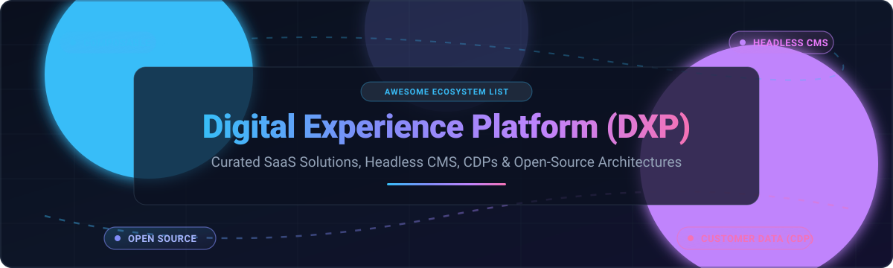

# 🌐 Awesome Digital Experience Platform (DXP) 🚀

  
  
  
  

**A curated index of Digital Experience Platforms (DXP), composable content architectures, headless CMS engines, customer data platforms (CDP), and enterprise experience software.** ⚡

---

## 📑 Table of Contents

- [📊 Sector Overview & Market Dynamics](#-sector-overview--market-dynamics)
- [💼 SaaS / Hosted DXP Platforms](#-saas--hosted-dxp-platforms)
- [🔓 Open-Source GitHub Projects](#-open-source-github-projects)
- [🏗️ Architectural Frameworks & Composable Stacks](#️-architectural-frameworks--composable-stacks)
- [🤝 How to Contribute](#-how-to-contribute)
- [💖 Support & Sponsorship](#-support--sponsorship)
- [⭐ Star History](#-star-history)
- [⚖️ Disclaimer & License](#️-disclaimer--license)

---

## 📊 Sector Overview & Market Dynamics

The global Digital Experience Platform (DXP) market is valued at approximately **$15 billion to $19 billion** and is projected to expand past **$45 billion+** at a compound annual growth rate (CAGR) of 12%–16%, propelled by generative AI orchestration, real-time personalization, and modular headless microservices. The sector exhibits a distinct structural duality: it is **moderately concentrated at the high-end enterprise tier** dominated by multi-cloud software giants (Salesforce, Adobe, Sitecore), while remaining **highly fragmented across mid-market and composable implementations** where agile headless CMS, edge content networks, and specialized customer data engines compete directly against monolithic suites. 📈

---

## 💼 SaaS / Hosted DXP Platforms

The following SaaS platforms lead the managed enterprise DXP and composable digital experience space. Ranked in descending order by parent company scale (market capitalization / enterprise valuation): 🏢

| Platform | Company Size (Valuation / Revenue) | Starting Tier Pricing | Free Tier / Trial Limits | Key Capabilities & Architecture |
| :--- | :--- | :--- | :--- | :--- |
| **[Salesforce DXP](https://www.salesforce.com/products/experience-cloud/overview/)** | **~$280B Market Cap** (~$35B+ ARR) | **$2/login/mo** (Login-based pool) or **$5/member/mo** (Customer Community) | **30-day free trial** (via core CRM trial with Experience Cloud features enabled) | Experience Cloud portal builder with Lightning Web Components, Einstein AI personalization, and native CRM integrations. |
| **[Adobe Experience Manager](https://business.adobe.com/products/experience-manager/sites/aem-sites.html)** | **~$220B Market Cap** (~$21B+ ARR) | **~$100,000/year** (Enterprise entry license contract) | **No free trial** (Requires custom enterprise consultation and guided demo) | Enterprise DXP suite combining AEM Sites (headless/hybrid CMS), AEM Assets (DAM), and Edge Delivery Services with auto-scaling cloud infrastructure. |
| **[Bloomreach](https://www.bloomreach.com/)** | **~$2.2B Valuation** (~$150M+ ARR) | **~$60,000/year** ($5,000/month baseline contract) | **No free trial** (Evaluation requires tailored sales sandbox and demo) | Commerce-focused DXP coupling Loomi AI search, catalog indexing (<50ms response times), merchandizing tools, and CDP-driven marketing automation. |
| **[Optimizely One](https://www.optimizely.com/)** | **~$1.5B Valuation** (~$400M+ ARR) | **~$36,000/year** ($3,000/month entry tier) | **No free trial** for full DXP (Free Rollouts plan limited to 1 active feature experiment) | Composable DXP integrating CMS13, experimentation tools, Opal autonomous AI agents, and 1:1 real-time buyer personalization. |
| **[Contentful](https://www.contentful.com/)** | **~$1.3B Valuation** (~$200M+ ARR) | **$300/month** (Lite tier) | **Free forever plan**: Up to 10 users, 100,000 API requests/month, 50 GB CDN bandwidth, 1 space (25 content types, 2 locales) | API-first composable content platform offering flexible content modeling, visual workspaces, and multi-channel REST/GraphQL delivery. |
| **[Sitecore](https://www.sitecore.com/)** | **~$1.2B Valuation** (~$500M+ ARR) | **~$40,000/year** (Entry modular subscription) | **No free trial** for core CMS (Sitecore Connect trial capped at 5,000 integration tasks/year) | Composable and hybrid enterprise DXP featuring Sitecore XM Cloud, Sitecore CDP, Personalize, and digital asset management. |
| **[Acquia DXP](https://www.acquia.com/)** | **~$1.0B Valuation** (~$350M+ ARR) | **~$20,000/year** (Acquia Cloud baseline tier) | **14-day free trial** for Cloud Platform (3 environments, built-in Cloud IDE); **30-day free trial** for Acquia DAM (up to 50 user seats) | Open enterprise DXP built on Drupal with 300+ CDP connectors, machine-learning customer journey mapping, and low-code site creation. |
| **[Storyblok](https://www.storyblok.com/)** | **~$800M Valuation** (~$80M ARR) | **$99/month** (Growth tier; $90.75/mo billed annually) | **Free forever plan**: 1 user seat (+1 for $15/mo), 1 space, 100,000 API requests/month, 100 GB traffic, 2 locales, 25,000 AI credits | Visual headless CMS with real-time in-context component editor, space-level localization, and schema-based block architecture. |
| **[Liferay DXP](https://www.liferay.com/)** | **~$150M+ ARR** (Bootstrapped enterprise) | **~$25,000/year** (Enterprise cluster subscription) | **Free Tier plan** with 12-month renewable production activation key (up to 3 clustered nodes); **30-day DXP sandbox trial** | Enterprise digital portal platform providing Data Platform, Content Marketing Studio, Digital Sales Rooms, and unified experience orchestration. |
| **[Magnolia DXP](https://www.magnolia-cms.com/)** | **~$50M+ ARR** (Private enterprise) | **$3,000/month** (Magnolia DX Core self-hosted entry) | **30-day free trial** (Full DX Core developer evaluation license) | Hybrid headless CMS and composable DXP enabling unified visual authoring across single-page applications, external e-commerce, and multi-channel apps. |

---

## 🔓 Open-Source GitHub Projects

Self-hosted, transparent, and developer-friendly DXP engines, headless content repositories, and experience frameworks. Ranked in descending order by GitHub stargazers count: 🌟

- **[Strapi](https://github.com/strapi/strapi)**   
  *Leading Open-Source Headless CMS (JavaScript / TypeScript, MIT License)* 🚀  
  Fully customizable, API-first headless CMS built on Node.js. Offers instant REST and GraphQL APIs, customizable admin panels, role-based access control (RBAC), and webhooks. Migrations from proprietary platforms like Contentful are supported via migration tooling.

- **[Ghost](https://github.com/TryGhost/Ghost)**   
  *Modern Publishing DXP & Creator Platform (Node.js / JavaScript, MIT License)* 👻  
  High-performance headless-capable digital publishing platform and newsletter CMS. Built on modern Node.js architecture with native subscription tiers, payment integration, rich card-based editor, and headless front-end delivery.

- **[Payload CMS](https://github.com/payloadcms/payload)**   
  *Code-First Headless CMS & Application Framework (TypeScript / Next.js, MIT License)* ⚡  
  Native Next.js and TypeScript full-stack CMS engineered for developers. Features automatic GraphQL/REST generation, code-driven content collections, deep React component extensibility, and native database support (PostgreSQL, MongoDB, SQLite).

- **[Directus](https://github.com/directus/directus)**   
  *Open-Data Platform & Real-Time Headless CMS (Node.js / TypeScript, BSL-1.1 / Apache-2.0)* 🐰  
  Instant REST and GraphQL data layer wrapping any SQL database (PostgreSQL, MySQL, SQLite, Oracle). Functions as a composable backend-as-a-service and digital asset management hub with no-code data studio and granular permission rules.

- **[WordPress](https://github.com/WordPress/WordPress)**   
  *Ubiquitous Web Experience Platform (PHP / MySQL, GPL-2.0)* 🌍  
  The world's most widely adopted open-source content engine, powering over 40% of the web. Features extensive plugin and theme ecosystems, block editing (Gutenberg), full site editing, and headless delivery via the native WordPress REST API and WPGraphQL.

- **[TinaCMS](https://github.com/tinacms/tinacms)**   
  *Git-Backed Headless CMS for Jamstack & Next.js (TypeScript / React, Apache-2.0)* 🦙  
  Git-backed headless content engine with real-time visual editing. Stores Markdown and MDX files directly inside your Git repository, providing version control, zero database overhead, and automatic GraphQL content queries.

- **[Umbraco CMS](https://github.com/umbraco/Umbraco-CMS)**   
  *Flexible Open-Source .NET DXP Alternative (C# / .NET, MIT License)* ⚙️  
  Enterprise .NET CMS frequently deployed as a cost-effective alternative to Sitecore. Provides intuitive back-office editing, headless delivery via Delivery API, strong performance, and integration hooks for DAM, ERP, and commerce solutions.

- **[ApostropheCMS](https://github.com/apostrophecms/apostrophe)**   
  *In-Context Modular Node.js CMS & Multi-Site DXP (Node.js / JavaScript, MIT License)* ✏️  
  Modular JavaScript CMS featuring on-page visual editing, drag-and-drop layouts, and multi-tenant site provisioning through Apostrophe Assembly. Supports unlimited locales without subscription fees.

- **[Drupal](https://github.com/drupal/drupal)**   
  *Enterprise Open-Source DXP Foundation (PHP / Symfony, GPL-2.0)* 💧  
  Enterprise-grade digital experience platform engine powering global brand portals and public sector sites. Serves as the open core foundation for Acquia DXP, featuring advanced taxonomy, modular entity structures, multilingual governance, and headless JSON:API.

- **[Pimcore](https://github.com/pimcore/pimcore)**   
  *Unified Data & Digital Experience Platform (PHP / Symfony, GPL-3.0)* 📦  
  Open platform integrating Product Information Management (PIM), Master Data Management (MDM), Digital Asset Management (DAM), Content Management (CMS), and digital commerce in a single centralized architecture.

- **[Liferay Portal](https://github.com/liferay/liferay-portal)**   
  *Enterprise Open-Source Digital Experience Platform (Java / OSGi, LGPL-2.1)* 🏛️  
  Open core of Liferay DXP providing role-based portals, content management, workflow automation, and collaboration workspaces. Supports Kubernetes and GCP deployments across major enterprise relational databases.

- **[dotCMS Core](https://github.com/dotCMS/core)**   
  *Hybrid-Headless Java Digital Experience Platform (Java, GPL-3.0)* 🎯  
  Scalable hybrid DXP supporting API-first headless content delivery alongside visual drag-and-drop page authoring, multi-site management, and personalization workflows.

- **[Silverstripe CMS](https://github.com/silverstripe/silverstripe-cms)**   
  *Extensible Content Management Framework (PHP, BSD-3-Clause)* 🔷  
  Intuitive web application framework and content manager with decoupled headless APIs, flexible data modeling, and developer tooling.

- **[Apache Unomi](https://github.com/apache/unomi)**   
  *Open-Source Customer Data Platform & Personalization Engine (Java / OSGi, Apache-2.0)* 🛡️  
  OASIS Context Server reference implementation for collecting customer profiles, tracking real-time web events, and executing rules-based audience segmentation with full GDPR compliance.

- **[Crafter CMS](https://github.com/craftersoftware/craftercms)**   
  *Git-Based Composable DXP (Java / Spring, GPL-3.0)* 🛠️  
  Decoupled CMS separating content authoring (Crafter Studio) from headless delivery (Crafter Engine) with Git-backed version control and DevContentOps workflow automation.

- **[Bloomreach Experience CMS Community](https://github.com/bloomreach/brxm)**   
  *Enterprise Open-Source Java CMS Core (Java, Apache-2.0)* 🌺  
  The open core framework behind Bloomreach's commercial experience platform, delivering flexible component-based page composition and multi-channel content APIs.

---

## 🏗️ Architectural Frameworks & Composable Stacks

Modern enterprise digital experience solutions have transitioned away from monolithic, single-vendor lock-in toward **composable, best-of-breed architectures**: 🧩

1. **Experience Orchestration Layer**: [Liferay Portal](https://github.com/liferay/liferay-portal), [Umbraco](https://github.com/umbraco/Umbraco-CMS), or [dotCMS](https://github.com/dotCMS/core) for unified portals and authenticated user intranets.
2. **Headless Content Layer**: [Strapi](https://github.com/strapi/strapi), [Payload CMS](https://github.com/payloadcms/payload), [Directus](https://github.com/directus/directus), or [Drupal](https://github.com/drupal/drupal) for REST/GraphQL schema delivery.
3. **Customer Data & Personalization Engine**: [Apache Unomi](https://github.com/apache/unomi) for privacy-compliant customer profiles, real-time segmentation, and trigger automation.
4. **Data & Asset Management**: [Pimcore](https://github.com/pimcore/pimcore) for unified product catalogs (PIM) and enterprise digital asset management (DAM).
5. **Modern Frontend Delivery**: Next.js, Nuxt, Astro, or Remix connected via automated edge CDNs (Cloudflare, Vercel, Fastly).

---

## 🤝 How to Contribute

Contributions are welcome! Please follow these guidelines: ✨

1. Fork this repository. 🍴
2. Add or update tools following the markdown table or badge format. 📝
3. Keep descriptions factual, unbiased, and include verified links. 🔍
4. Submit a Pull Request explaining the proposed addition or correction. 🚀

---

## 💖 Support & Sponsorship

Thank you so much for exploring this curated repository! If you find this project helpful or valuable for your development stack, research, or enterprise architecture decisions, please consider supporting the project: 🙌

- ⭐ **Star** this repository on GitHub to help others discover it.
- 🍴 **Fork** and contribute additions, corrections, or modern DXP updates.
- 📢 **Share** with your fellow developers, engineers, and digital architects.
- ☕ **Buy me a coffee / Sponsor**: Support ongoing maintenance and research via the [GitHub Sponsors Dashboard](https://github.com/sponsors/ishandutta2007).

---

## ⭐ Star History

---

## ⚖️ Disclaimer & License

- 📖 This list is community-curated for informational, architectural, and educational purposes.
- 🚫 Mentions do not imply commercial endorsement.
- 🏷️ All brand names and trademarks belong to their respective owners.
